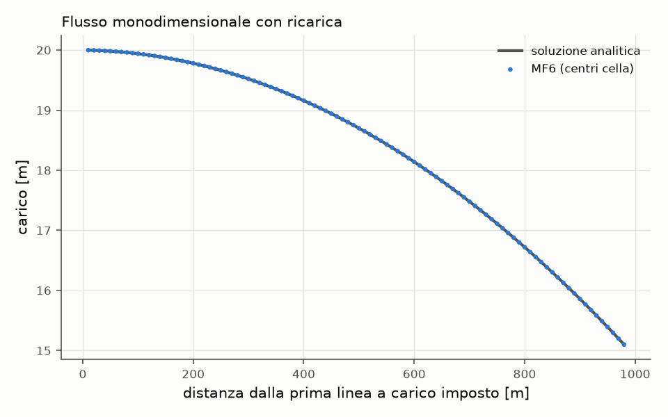
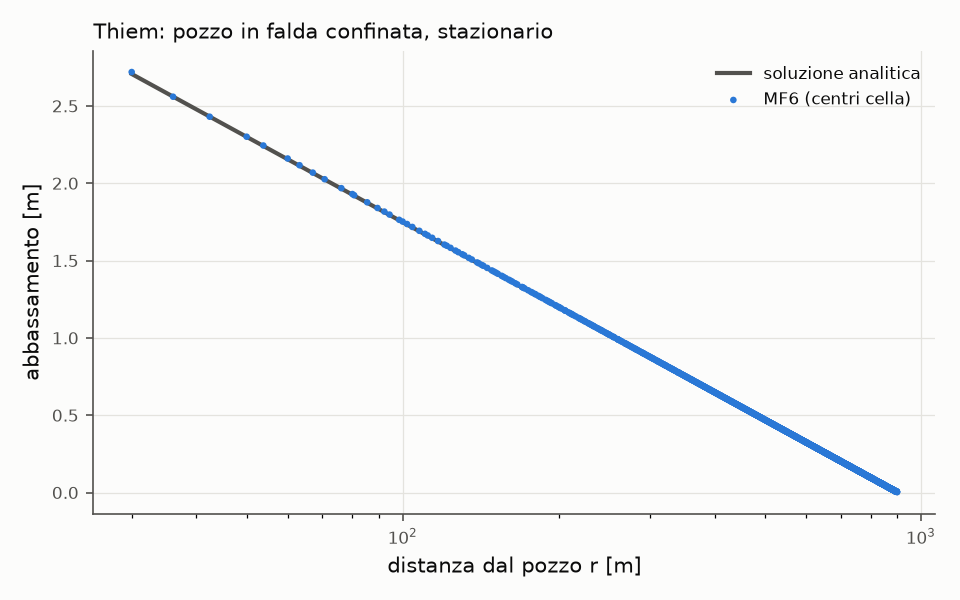
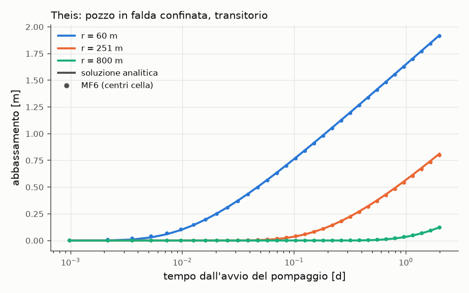
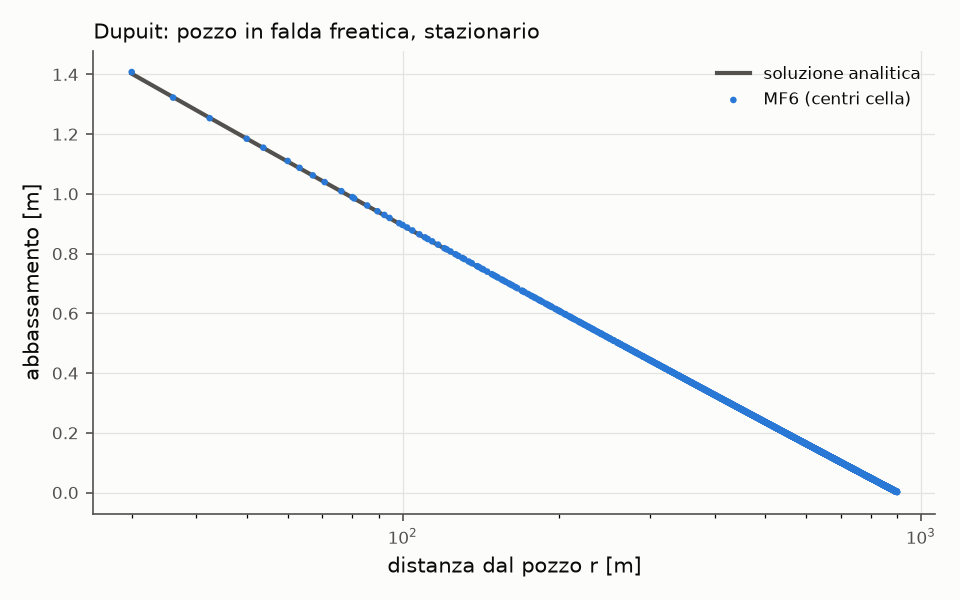

# Verifica di Phrear

phrear 0.1.0.dev0, MODFLOW 6 6.8.1, 2026-11-03 20:34.

Ogni caso è un progetto Phrear completo, costruito, controllato ed eseguito con MODFLOW 6 come un progetto dell'utente. I risultati ai centri cella sono confrontati con la soluzione analitica.

| Caso | Errore massimo [m] | Riferimento [m] | Misura | Tolleranza | Esito |
|---|---|---|---|---|---|
| Flusso monodimensionale con ricarica | 2.89e-05 | 1 | 2.9e-05 m | 0.0001 m | superato |
| Thiem: pozzo in falda confinata, stazionario | 0.0126 | 2.71 | 0.466 % | 1 % | superato |
| Theis: pozzo in falda confinata, transitorio | 0.0214 | 1.92 | 1.11 % | 3 % | superato |
| Dupuit: pozzo in falda freatica, stazionario | 0.00558 | 1.4 | 0.398 % | 3 % | superato |

## Flusso monodimensionale con ricarica

Falda confinata tra due linee a carico imposto (20 m e 15 m, distanza 990 m), T = 100 m²/d, ricarica 365,25 mm/anno; regime stazionario.

Parametri: cella 10 m, celle 100 × 10. 98 punti di confronto; errore massimo in m 2.9e-05 m, tolleranza 0.0001 m.

## Thiem: pozzo in falda confinata, stazionario

Q = 500 m³/d, T = 100 m²/d, carico imposto 20 m oltre R = 900 m; punti di confronto ad almeno 3 celle dal pozzo.

Parametri: cella 10 m, celle 201 × 201. 25412 punti di confronto; errore massimo / s_max 0.466 %, tolleranza 1 %.

## Theis: pozzo in falda confinata, transitorio

Q = 500 m³/d per 2 giorni, T = 100 m²/d, S = 10⁻³; punti tra 3 celle e 1000 m dal pozzo, a ogni passo; il contorno a 1950 m non è raggiunto dal cono.

Parametri: cella 20 m, celle 201 × 201, primo passo 0,001 d. 258060 punti di confronto; errore massimo / s_max 1.11 %, tolleranza 3 %.

## Dupuit: pozzo in falda freatica, stazionario

Q = 500 m³/d, K = 10 m/d, base a 0 m, carico imposto 20 m oltre R = 900 m, formulazione di Newton; punti ad almeno 3 celle dal pozzo.

Parametri: cella 10 m, celle 201 × 201. 25412 punti di confronto; errore massimo / s_max 0.398 %, tolleranza 3 %.

